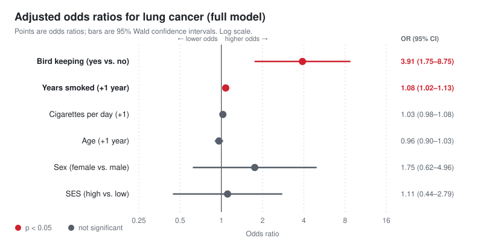
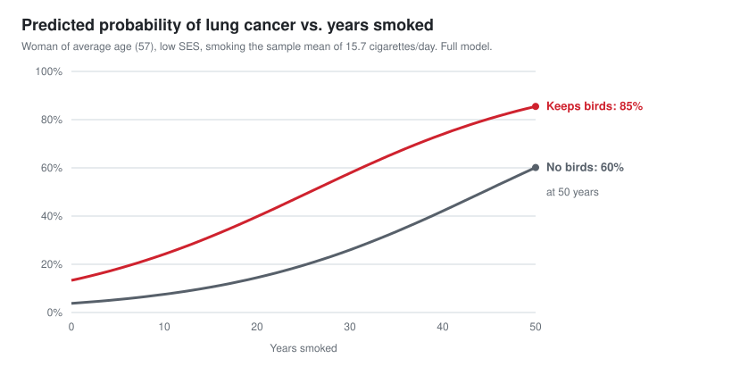

# Bird Keeping and Lung Cancer: A Logistic Regression Analysis


**Does keeping pet birds raise the odds of lung cancer, even after accounting for smoking?**

This project fits a multiple logistic regression in SAS to data from a lung cancer case–control study. It estimates the association between bird keeping and lung cancer while adjusting for smoking history, age, sex and socioeconomic status.

## Key findings

| | Result |
|---|---|
| **Bird keeping** | After adjustment, bird keepers had **3.9× the odds** of lung cancer (95% CI 1.75–8.75, p = 0.0009) |
| **Smoking duration** | Each additional year of smoking multiplied the odds by **1.08** (95% CI 1.02–1.13), about **2.1× per decade** |
| **Model comparison** | Dropping bird keeping significantly worsens fit: likelihood-ratio **G = 11.67, df = 1, p = 0.0006** |
| **Discrimination** | Concordance (c-statistic) rises from **0.723 → 0.775** when bird keeping is added |
| **Illustration** | For a non-smoking woman of average age and low SES, predicted probability is **9.3% with birds vs. 2.5% without** |

<p align="center">
  
</p>

<p align="center">
  
</p>

## Data

147 subjects from a case–control study in The Hague, Netherlands (Holst, Kromhout & Brand, 1988), distributed as Case Study 20.2 in Ramsey & Schafer's *The Statistical Sleuth*. The 49 lung cancer cases and 98 controls give a 1:2 ratio.

| Variable | Type | Coding / summary |
|---|---|---|
| `Lung_Cancer` | Response | 1 = case (33.3%), 0 = control |
| `Birdkeeping` | Exposure of interest | 1 = keeps birds (45.6%), 0 = no |
| `Sex` | Covariate | 1 = female (24.5%), 0 = male |
| `Socioeconomic_Status` | Covariate | 1 = high (30.6%), 0 = low |
| `Age` | Covariate | mean 57.0, SD 7.3, range 37–67 |
| `Years_smoked` | Covariate | mean 27.9, SD 14.0, range 0–50 |
| `Cigarettes_per_day` | Covariate | mean 15.7, SD 9.7, range 0–45 |

See [`data/README.md`](data/README.md) for how to get the data file.

## Methods

1. **Exploratory analysis:** `PROC MEANS` and `PROC FREQ` to summarize every variable and check coding and ranges.
2. **Full model:** `PROC LOGISTIC` with all six predictors:

   $$\text{logit}\,P(\text{cancer}) = \beta_0 + \beta_1\,\text{Sex} + \beta_2\,\text{SES} + \beta_3\,\text{Bird} + \beta_4\,\text{Age} + \beta_5\,\text{YrsSmoked} + \beta_6\,\text{CigsPerDay}$$

3. **Inference on coefficients:** Wald tests, odds ratios $e^{\beta_k}$ and 95% Wald confidence intervals $e^{\beta_k \pm 1.96\,SE}$, computed by hand in `PROC IML` to verify the SAS output.
4. **Predicted probabilities:** the inverse logit, $p = e^{\eta}/(1+e^{\eta})$, for specific covariate profiles.
5. **Nested-model test:** a drop-in-deviance likelihood-ratio test comparing the full model against a reduced model without bird keeping.

## Model comparison

| | Full model (with bird keeping) | Reduced model (without) |
|---|---:|---:|
| −2 log L | **154.20** | 165.87 |
| AIC | **168.20** | 177.87 |
| Likelihood-ratio χ² vs. null | 32.94 (df 6, p < .0001) | 21.27 (df 5, p = .0007) |
| c-statistic (AUC) | **0.775** | 0.723 |
| Percent concordant | **77.4%** | 72.2% |

## Interpretation and limitations

- **Association, not causation.** This is an observational case–control study. The odds ratio quantifies an association that holds after adjusting for the measured covariates. Unmeasured confounders could still explain it.
- **Case–control sampling.** Because subjects were sampled by outcome (1 case : 2 controls), the **odds ratios are valid** estimates. The **absolute predicted probabilities are not population risks**: they reflect the study's 33% case rate and are useful only for comparing profiles.
- **Smoking matters most in duration.** Once years smoked is in the model, cigarettes per day adds little (p = 0.31). The two variables are likely correlated.
- **Small sample.** With n = 147, confidence intervals are wide (bird keeping: 1.75–8.75), so the size of the effect is estimated imprecisely even though its direction is clear.

A full walkthrough of each result is in [`docs/analysis.md`](docs/analysis.md).

## Repository structure

```
.
├── sas/
│   └── birdkeeping_lung_cancer.sas   # Complete, commented SAS program
├── results/
│   ├── sas_output.pdf                # Full SAS output (tables, model fit, estimates)
│   └── sas_log.pdf                   # SAS execution log
├── figures/
│   ├── odds_ratios.svg               # Forest plot of adjusted odds ratios
│   └── predicted_probability.svg     # Predicted probability curves
├── scripts/
│   └── make_figures.py               # Regenerates figures (Python stdlib only)
├── docs/
│   ├── analysis.md                   # Detailed write-up of results
│   └── original_writeup.pdf          # Original written responses
└── data/
    └── README.md                     # Data source, codebook, how to obtain
```

## Reproducing

1. Get the data file as described in [`data/README.md`](data/README.md) and save it as `data/birdlung.data.txt`.
2. Run [`sas/birdkeeping_lung_cancer.sas`](sas/birdkeeping_lung_cancer.sas) in SAS 9.4 or SAS OnDemand for Academics. Update `%let datafile` if your path differs.
3. To regenerate the figures, run:
   ```bash
   python3 scripts/make_figures.py
   ```

## Skills demonstrated

`Multiple logistic regression` · `Odds ratio interpretation` · `Wald and likelihood-ratio tests` · `Nested model comparison` · `Confounder adjustment` · `Model discrimination (c-statistic)` · `SAS: PROC LOGISTIC, PROC FREQ, PROC MEANS, PROC IML` · `Communicating causal limits of observational data`

## Reference

Holst, P. A., Kromhout, D., & Brand, R. (1988). For debate: Pet birds as an independent risk factor for lung cancer. *British Medical Journal*, 297(6659), 1319–1321.

Ramsey, F. L., & Schafer, D. W. *The Statistical Sleuth: A Course in Methods of Data Analysis*, Case Study 20.2.
